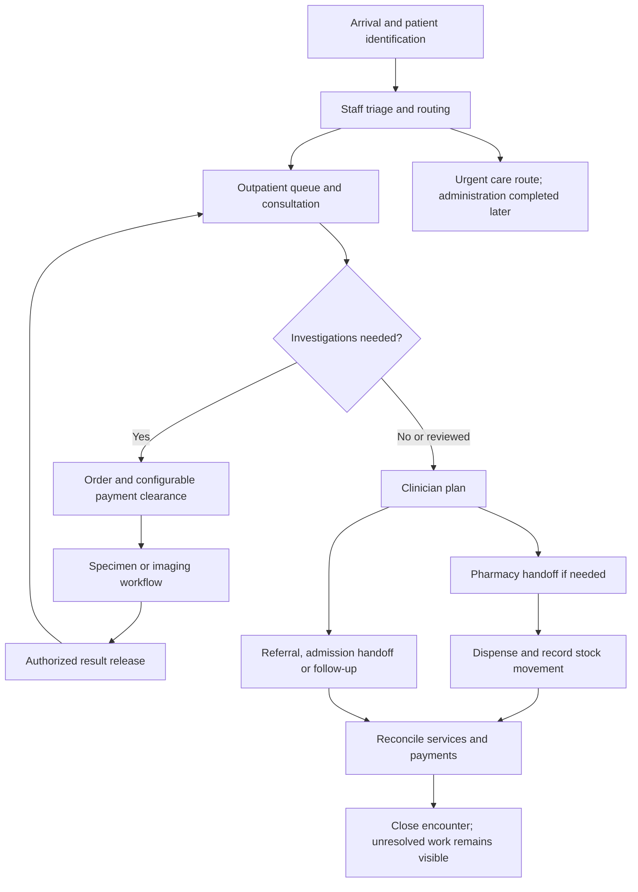

# Ethiopian hospital workflows and requirements

## Decision and recommendation

Public evidence is sufficient to draft realistic workflows and build a synthetic-data prototype without an existing hospital contact. Start with an outpatient journey including diagnostic and pharmacy handoffs, configurable payment checkpoints, and downtime recovery. For the proposed prototype, registration, consultation and a final bill alone would omit diagnostic and pharmacy handoffs described in these sources.

This is a **proposed product direction**, not a validated purchasing case or approved clinical specification. Eleven Ethiopian original studies were reviewed in the digests; the most decision-relevant are cited below. Public-hospital and historical evidence are separated from private-facility findings. No staff were contacted, patient records collected, or video transcripts successfully inspected.

## Findings and implications

**Installation does not establish clinical adoption.** A study published in 2025 surveyed 351 professionals in February–March 2023 at four private Bahir Dar hospitals that had initiated EMR use. Respondents reported using the EMR for billing more often than for clinical documentation or laboratory ordering. Fieldwork was in 2023; clinics were excluded. These are self-reports, not usage logs or current national adoption estimates. **Confidence: medium; single-study finding.** Proposed implication: measure complete departmental workflows rather than logins or invoices alone. [1]

**Patient journeys branch and loop.** Observation at three public Jimma Zone hospitals followed registration, triage, examination, diagnostics and pharmacy, including result-review waiting. Publication was in 2024, but observation in 2018. [2] A separate 2018 single-hospital laboratory study described order → quotation → cashier → payment confirmation → specimen queue; ownership was unspecified. [3] **Confidence: medium for historical branching, low for today's exact private-facility sequence.** Proposed implication: keep encounter, queue, order, specimen and payment states separate; configure payment checkpoints.

**Orders and results need accountable handoffs.** Twenty-five interviews in an Addis Ababa hospital and three health centers using Bahmni described missing laboratory units/reference ranges, correction limitations, outside-result attachment gaps, medication orders not reaching pharmacy, and laboratory requests arriving late. Reporting sometimes involved copying information between records. **Confidence: medium; single qualitative sample, not measured failure rates.** Proposed implication: visible destination/receipt status, authored amendments, outside-result provenance and an explicit result-review task. [4]

**Downtime has a human recovery workflow.** Eight interviewees across five Bahir Dar facilities, three private and two government, described interruptions, recording on paper followed by re-entry, message delays and dependence on available support staff. Individual failures cannot all be attributed to private hospitals. **Confidence: medium-low; small qualitative sample and unclear collection dates.** [5] A separate mixed-methods study at the public Yekatit 12 hospital described phased departmental deployment, training gaps and continuing manual reporting. **Confidence: medium; one large public hospital.** [6] Proposed implication: rehearse recovery, assign reconciliation ownership, prevent duplicate re-entry and provide backup support coverage. These findings do not by themselves select cloud, local or hybrid deployment.

**Pharmacy is more than a sale.** The Ministry of Health's 2017 pharmacy guidance separates prescription review, transaction recording, preparation, labeling, counseling and filing. It describes batch/expiry traceability, cash/free/credit transactions and reconciliation. **Confidence: high for historical document contents; current applicability unverified.** [7] Proposed implication: distinguish prescription, dispensing, stock movement and payment. Payment must not silently mean medicine was dispensed.

## Proposed workflow to test

This is a synthesis for a demo, not one universally observed hospital process. Ordinary branches draw on [2], [3], [4] and [7]. The urgent route is a proposed safety requirement requiring clinician validation, not a triage protocol. Payment may occur at registration, before tests, at pharmacy or settlement according to approved facility rules.

Reception, clinical staff, diagnostics, cashiers and pharmacy need role-specific worklists and accountable handoffs. A small facility may assign multiple roles to one person; permissions should remain explicit. Patient, visit, clinical note, order, result, prescription, stock movement, invoice and payment are separate records even when presented together.

## Product implications and remaining decisions

**2026-10-13 supplement:** the user supplied a student software design project.
Its [assessment](student-project-assessment.md) contributes registration and
access-control design questions, separately from the empirical sources below.
It does not validate cross-hospital sharing or change our customer boundary.

Use [requirements.md](requirements.md) as PRD and prototype input. Revise the earlier brief: lab and pharmacy **handoffs belong in discovery and the prototype**. Full laboratory operations, pharmacy inventory, inpatient care, insurance and external integrations still need scope decisions. A live release must implement agreed steps or explicitly support handoffs to existing work.

One configurable product with isolated hospital organizations remains the direction. Security controls from the existing brief are engineering requirements; these studies do not prove security or legal compliance. Continue the deployment comparison without treating outages as an automatic argument for complex offline synchronization.

Evidence of existing EMRs means this is not an empty market. We have not established reasons to switch, willingness to pay, preferred languages/calendars, reporting obligations, migration formats or infrastructure costs. Existing software problems do not prove demand for our product. No full adversarial market review was performed.

Proceed without contacts by preparing synthetic role walkthroughs. Later recruit independent reception, clinical, diagnostic, pharmacy and finance reviewers, plus owners for buying questions. Before live use, qualified facility staff must validate identity handling, clinical records, corrected results, dispensing, downtime and reports. No outreach has been sent.

## What other research methods add

Published interviews reveal staff experiences; observation reveals sequences; guidance describes intended processes rather than actual behavior. Bahmni's written 2015 JSS observations in India describe returning-patient searches and clinician–lab–clinician loops. Use these as historical foreign comparisons only. [8]

Bahmni's official demo page links a 13-video playlist covering registration, clinical records and investigations. The catalogue was inspected; **the videos were not watched**. No requirement depends on uninspected video content. [9] No usable Ethiopian workflow documentary transcript was retrieved within this search, which does not mean none exists.

JSI's listing describes Ethiopia's EHR standard as covering public/private facilities and suppliers. The linked MOH PDF was inaccessible; a mirror returned 403. Detailed requirements, current edition and enforcement remain unverified. Do not claim conformance from the listing. [10]

## Verification and freshness

The research pass is complete; requirements remain provisional. The findings supporting the main recommendation received independent spot checks. Partial adoption and interruptions were corroborated across separate studies. Paper fallback followed by re-entry was verified directly in [5], but not independently replicated; reconciliation is a proposed requirement. See [verification digest](digests/verification-r1.md). Other claims supported by only one source have not been independently corroborated, even when the original source was read.

Re-check the current EHR standard before the compliance matrix or production architecture is finalized. Historical 2015–2018 pathways are scenario inputs, not 2026 prevalence evidence. Refresh evidence on staff experiences 18 months after publication or sooner when choosing a pilot. Publication recency does not erase older fieldwork. Validate every proposed flow at the pilot regardless of paper age. Inspect video contents before extracting video-specific requirements. The automated freshness check flags five of nine dated source claims for re-checking; historical descriptions are retained only with their stated limitations. The undated video catalogue is outside that date calculation.

Terminology: EMR/EHR = electronic medical/health record; OPD = outpatient department; APTS = auditable pharmaceutical transactions and services; DHIS2 = health-information reporting platform, not a verified integration in this product.

## Sources

All accessed **2026-10-12**. Confidence describes bounded findings, never national prevalence.

| Ref | Source and publisher | Published; fieldwork | Limitation |
| --- | --- | --- | --- |
| [1] | [Private EMR usage, Scientific Reports](https://www.nature.com/articles/s41598-025-22186-w) | 2025-11-03; Feb–Mar 2023 | Four private EMR adopters; clinics excluded; self-report |
| [2] | [Outpatient pathways, PLOS ONE](https://journals.plos.org/plosone/article?id=10.1371/journal.pone.0296630) | 2024-03-07; Mar–May 2018 | Three public hospitals; historical observation |
| [3] | [Laboratory workflow, Medwin](https://medwinpublishers.com/article/EOIJ/10.23880/eoij-16000179/full) | 2018-09-17; collection date unclear | One hospital, ownership unspecified; older weaker source |
| [4] | [EMR adoption interviews, SAGE DIGITAL HEALTH](https://journals.sagepub.com/doi/10.1177/20552076241301946) | 2024-12-10; June 2023 | 25 interviews; hospital/health centers using Bahmni |
| [5] | [Implementation barriers, AOSIS Health SA Gesondheid](https://www.scielo.org.za/scielo.php?pid=S2071-97362025000100102&script=sci_arttext) | 2025-09-20; collection date unclear | Eight interviews; mixed ownership; methodological limitations |
| [6] | [Yekatit 12 implementation, PLOS ONE](https://journals.plos.org/plosone/article?id=10.1371/journal.pone.0329896) | 2025-08-06; Feb–June 2023 | Public hospital; 389 respondents and ten informants |
| [7] | [EHSTG Pharmacy chapter, Ethiopian MOH via GHSC-PSM](https://www.ghsupplychain.org/sites/default/files/2018-11/Pharmacy%20Services%20-%20Hospitals%20Management%20Initiative.pdf) | August 2017 | Historical normative guidance; printed pp.13–21 |
| [8] | [JSS field notes, Bahmni](https://bahmni.atlassian.net/wiki/spaces/BAH/pages/13697039/JSS) | Updated 2015-11-10 | India, historical comparator |
| [9] | [Official demos, Bahmni](https://www.bahmni.org/demo) | Undated | Catalogue only; videos unverified |
| [10] | [Ethiopian EHR standard listing, JSI/DUP](https://ethiopiadup.jsi.com/resource/standard-for-electronic-health-record-system-ehrs-in-ethiopia/) | February 2022 | Full standard inaccessible |
