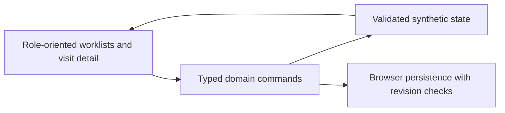

# First prototype: boundaries and next architecture decisions

Updated2026-10-13. This document describes the intended first implementation,
not production assurance. See `prototype.md` for verified commands and evidence.

## Current scope distinction

This document describes the original `/` outpatient walkthrough. A subsequent
`/staff` workspace now provides authenticated registration and outpatient visits
using PostgreSQL, server sessions, hospital boundaries and role-projected APIs.
See [staff-workspace.md](staff-workspace.md) for its implementation and limits.
The walkthrough's clinical records remain browser-only; no import or shared data
path connects the two. Production architecture and clinical validation remain open.

## What this slice should prove

The founder can walk a fictional patient through an outpatient encounter:
registration, clinical note, diagnostic handoff, result review, prescription
fulfillment and demo financial settlement. Worklists reflect the same underlying
visit. Pending work prevents premature closure. Refresh preserves demo progress.
The user selected a calm workspace with light backgrounds, teal accents and
clear patient lists.

## Implementation boundary

A React/TypeScript application keeps domain transitions separate from rendering
and browser persistence. Vite provides local development and bundled output;
Radix provides accessible dialog primitives. This is a practical prototype
choice, not the final hosted/on-premises architecture. Official references:
[React](https://react.dev/learn/build-a-react-app-from-scratch),
[Vite](https://vite.dev/guide/), [Radix Dialog](https://www.radix-ui.com/primitives/docs/components/dialog).

The model must distinguish people, encounters, orders, result review,
prescriptions, fulfillment, charges and payments. Financial amounts use integer
minor units; timestamps retain ordering and presentation uses an explicit
locale/timezone. Registration is independent of portal login.

## What it does not establish

| Concern | Current boundary | Needed before live use |
| --- | --- | --- |
| Authorization | No authenticated users or enforceable clinical roles | Server-enforced access, sessions, hospital isolation, lifecycle tests |
| Data storage | Synthetic data in this browser; user can modify it | Transactional server persistence, migrations, verified restore and retention |
| Audit | Demo event history for explaining actions | Accountable identities, tamper-resistant audit and release policy |
| Payments | Manual demo settlement; no money moves | Validated cash/refund/reconciliation rules and chosen payment integrations |
| Clinical use | Fictional scenarios; no decision support | Qualified review of fields, exceptions, amendments and responsibility |
| Medication | Demo prescription/fulfillment handoff | Pharmacy review, stock/batch/expiry handling and dispensing safeguards |
| Availability | Static local app and browser storage | Measured outage requirements and selected hosting/recovery design |
| Interoperability | No exchanges or DHIS2 integration | Agreed mappings, contracts, delivery tests and current standards |

A browser worklist grouped by staff function is not access control. A local
payment record is not a real receipt or payment integration. A successful
static build is not a production release. No patient information should be
entered into this prototype.

## Verification focus

The checks should exercise actual domain failures: impossible order transitions,
repeat settlement, duplicate active visits, unfinished-work closure, invalid
stored data and stale-tab writes. Browser coverage should include no-email
registration, an entire visit with a test, persistence after refresh, keyboard
access, empty filters, and desktop/mobile layout. Additional source/security
scans supplement these checks; they do not establish clinical or regulatory
compliance.

## Next production decisions

Use these development slices to validate the workflow and assess the initial
backend/authentication/organization boundary before expanding clinical scope.
Choose a production hosting arrangement and operational support model. Domestic hosting/local deployment remains undecided. Resolve live-data
location, applicable healthcare/privacy requirements, recovery targets and
clinical sign-off before selecting production services. Published research and
student designs remain inputs, not substitutes for facility validation.
